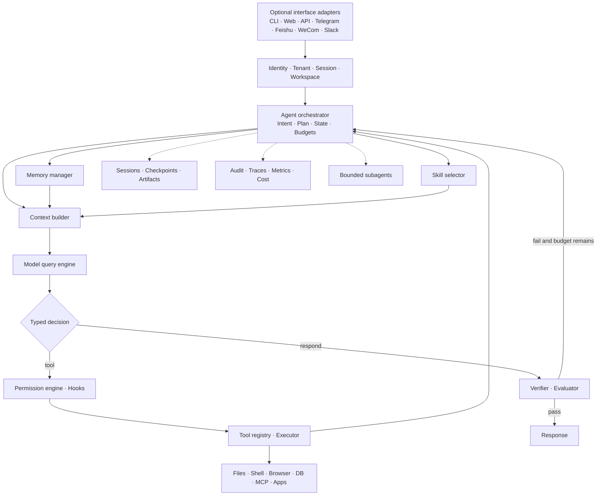
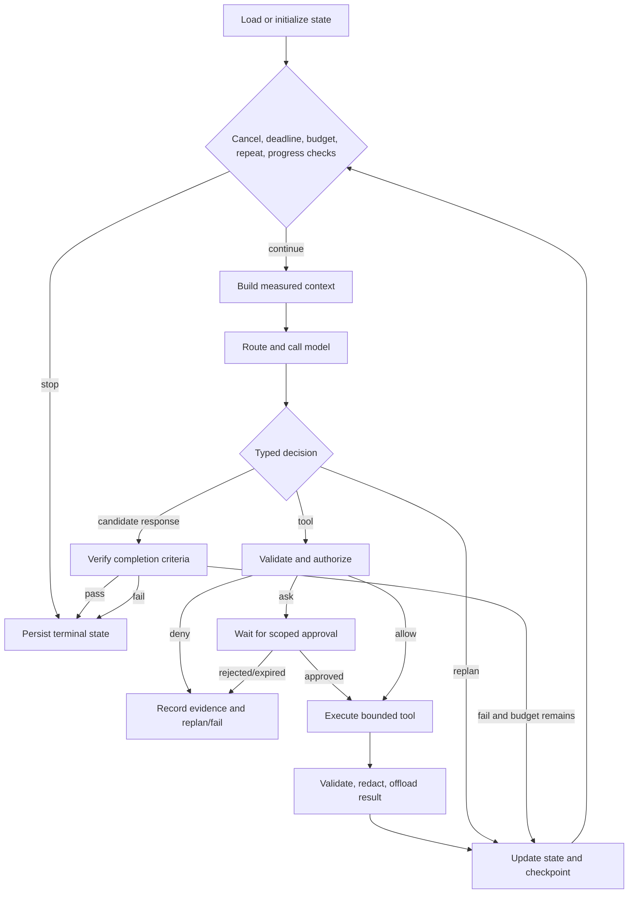

# AI Agent Engineering

AI Agent Engineering provides engineering methods and practical standards for agent systems, covering the full lifecycle from design, building, refactoring, debugging, extension, testing, and auditing to documentation and production delivery.

This Skill follows one basic principle: the model makes decisions only within typed contracts, while deterministic code handles authorization, budgets, execution, persistence, and verification. The result is an incremental system that can run, be tested, and be audited, rather than a single script or a prompt-only solution.

Use this Skill to create or upgrade workspace coding agents, durable tool-using agents, research and RAG agents, computer-control agents, and multi-agent systems. It also supports upgrading an existing chatbot or one-shot LLM call into a safe, durable, testable agent system.

## Contents

- [What It Solves](#what-it-solves)
- [Core Capabilities](#core-capabilities)
- [Client and Memory Platform Profiles](#client-and-memory-platform-profiles)
- [Design Principles](#design-principles)
- [Operating Modes](#operating-modes)
- [Phased Build P0–P10](#phased-build-p0p10)
- [Optional Integration Rules](#optional-integration-rules)
- [When to Use It and When Not To](#when-to-use-it-and-when-not-to)
- [Quick Start](#quick-start)
- [Directory Structure](#directory-structure)
- [Requirements](#requirements)
- [Installation](#installation)
- [Usage](#usage)
- [Configuration and Contracts](#configuration-and-contracts)
- [Templates](#templates)
- [Examples](#examples)
- [Reference Guide](#reference-guide)
- [Security and Human Control](#security-and-human-control)
- [Verification and Deliverables](#verification-and-deliverables)
- [Combining with Other Skills](#combining-with-other-skills)
- [FAQ](#faq)
- [Development and Testing](#development-and-testing)
- [Contributing](#contributing)
- [License](#license)

## What It Solves

Many coding agents can produce code that runs, but do not necessarily take the following steps on their own:

- Understand the existing repository, engineering constraints, and uncommitted changes before editing.
- Turn business objectives into typed contracts, capability matrices, and acceptance criteria backed by evidence.
- Implement security, permissions, budgets, and cancellation as **deterministic code**, rather than relying on the model to follow prompt instructions voluntarily.
- Distinguish writing a plan from executing it and passing verification.
- Report `blocked` honestly when tools, authority, or evidence are missing, rather than pretending to be finished.
- Deliver recoverable sessions, checkpoints, memory, observability, and production-readiness evidence.
- Treat Channel, Model Provider, and MCP connections as **optional, configurable, replaceable** integrations rather than hard-coded choices.

`ai-agent-engineering` organizes these actions into a reusable agent-engineering workflow. It is not a code generator for a particular framework and does not choose your project's stack. It helps an agent discover, design, implement, verify, and deliver an agent system using production engineering methods.

## Core Capabilities

| Capability Area | What It Covers |
| --- | --- |
| DESIGN | Product scope, architecture, contracts, threat models, data models, phase plans, and acceptance criteria |
| FACTORY | Enterprise requirements converted into an Agent Blueprint, deterministic Build Recipe, candidate project, evidence mapping, and human release checklist |
| BUILD | Runnable agent increments from scratch: safety before features, a complete loop before expansion |
| REFACTOR | Modularization of a monolithic `agent.py`/`agent.ts`, preserving behavior with before-and-after contract tests |
| AUDIT | Read-only inspection of capability, architecture, security, evaluation, and production-readiness gaps, with file-linked evidence |
| DEBUG | Reproduction and localization of failures in loops, tools, context, memory, permissions, persistence, routing, or integrations |
| EXTEND | One bounded tool, Skill, Hook, MCP integration, model, Channel, memory behavior, or subagent at a time |
| TEST | Deterministic tests, scenarios, evaluations, and regression gates |
| DOCUMENT | Architecture, operations, deployment, and user documentation kept consistent with current code |
| RUNTIME | Bounded agent loops, planning/replanning, cancellation, timeouts, budgets, failures, and no-progress detection |
| TOOLS | Typed tool registries, command/path/network safety, timeouts, and output limits |
| CONTEXT | Token budgets, artifact offloading, compaction, and injection boundaries |
| MEMORY | Lifecycle, consent, retrieval, conflicts, isolation, and deletion |
| Sessions and Checkpoints | Persistence, recovery, rewind, idempotency, and migration |
| Permissions and Approvals | ALLOW/DENY/ASK, parameter-bound approvals, and credential protection |
| Lifecycle Hooks | Event buses, deterministic policy injection, and failure behavior |
| Subagents | Bounded delegation, budgets, DAGs, and structured merging |
| MCP Integration | Lazy discovery, adapters, trust, and degradation |
| Model Routing | Capability/privacy/budget routing, fallback, and failover |
| Multi-user Isolation | Tenant/user/workspace/cache/credential isolation |
| Observability | Logs, traces, metrics, audit, cost, and SLOs |
| Testing and Evaluation | Test pyramids, evaluation cases, judges, and regression gates |
| Production Readiness | Release checklists, canaries, incidents, and rollback |
| Security Models | Threat models, abuse cases, and denial policies |

## Client and Memory Platform Profiles

The Factory uses three independent profile groups so that an agent can quickly
build another agent while preserving an enterprise upgrade path. Experience selects
`headless`, `browser_chat`, `operations_console`, or `native_chat`; Memory selects
disabled, `local`, `hybrid`, or `enterprise`; Delivery selects `plan_only`,
`guided_install`, or `end_to_end`. Older Blueprints that omit these fields remain
valid and use safe defaults: headless, local Memory disabled, and plan-only delivery.

The first browser reference stack is React/Vite + FastAPI, with conversations, a
Run timeline, approvals, artifacts, Memory, and an optional operations console.
The browser displays safe projections only; agent execution, authorization, and
credential resolution remain within the governed Runtime boundary. The browser
reference Memory prototype uses SQLite + FTS5, and the enterprise reference uses
PostgreSQL; neither forces migration of existing storage. Each record class has
one authoritative owner, while independent encrypted files and scoped Markdown
may be retained; derived indexes have their own lifecycle. See
`references/client-experience.md`, `references/browser-experience.md`, and
`references/memory-deployment.md`.

The browser candidate also includes a responsive frontend, backend control-plane
contracts, Vitest/TypeScript/Vite gates, Playwright desktop/tablet/mobile workflows,
and a packaging script that syncs only verified build artifacts. The user must
still explicitly select dependency installation and service startup in a later
delivery task; the Factory does not perform them automatically.

Native `native_chat/native_cli` supports `stdio/local_ipc` planning and manifests without requiring WebView, HTTP, React, or a second Runtime. The current Factory can generate a core candidate, but native GUI and `encrypted_files/scoped_markdown` memory adapters remain `planned`; they must not be described as fully generated implementations. A Blueprint's `max_steps=0` can express no fixed step-count limit; the older execution scaffold lacks the complete safeguards, so apply rejects it before writing and requires integration with an existing governed Runtime.

Additional references to load as needed:

- [Client experience and rich messages/IME](references/client-experience.md), [native CLI clients and launchers](references/native-cli-client.md).
- [Actual capability status and retirement](references/capability-readiness.md), [sources/Readers/batching](references/document-source-pipelines.md).
- [Deterministic prompts and controlled learning](references/prompt-policy-learning.md), [runtime resource migration/cleanup](references/runtime-storage-operations.md).

Experience updates should capture general engineering methods and independently
constructed synthetic examples only. Permission to update or publish a Skill does
not permit publishing the originating project's name, source code, architecture
snapshots, specific configuration, paths, screenshots, or operational history.
Those disclosures require separate explicit authorization for the exact content
and destination; removing the project name alone does not anonymize the material.

## Design Principles

### The Model Proposes; Deterministic Code Decides

The central principle is: **the model may propose plans, generate decisions, and call tools, but deterministic code must own all authorization, budgets, execution, persistence, and verification**. Model output, retrieved content, memory, Skills, Hooks, MCP metadata/results, and subagent results are **untrusted inputs**. They can never expand tools, permissions, credentials, workspaces, budgets, or tenant scope.

Every side effect must pass through the same deterministic permission path. A hard deny takes precedence. Actions requiring human approval bind the principal, Run, tool/version, normalized arguments, risk, and expiry; changed arguments require new approval.

### Layered Architecture

The runtime consists of replaceable modules connected through explicit contracts. The recommended layers are shown below; see `assets/architecture-diagram.mmd`:



Required architecture invariants:

- Domain contracts **do not depend** on Provider SDKs, CLI frameworks, databases, or MCP libraries; adapters depend inward on contracts.
- Checkpoints, artifacts, audit, telemetry, evaluations, routing, and subagents act as **sidecar services**.
- Persist legal state transitions, version checkpoints, and fingerprint configuration.
- Propagate identity/tenant/session/workspace scope **immutably** through tools, jobs, Hooks, subagents, MCP, storage, and telemetry.
- Support end-to-end cancellation, deadlines, idempotency, structured errors, configuration provenance, and secret redaction.
- Separate the control plane—configuration, policies, tool/Skill catalogs, model profiles, routing, feature flags, and evaluation definitions—from the data plane—messages, tool inputs/outputs, artifacts, memory, sessions, and telemetry—with independent authorization and retention.

### The Non-negotiable Control Loop

Every agent runtime must implement the following loop; see `assets/agent-loop.mmd`:



Key points:

1. Before each iteration, check cancellation, deadlines, steps/replans, Tokens/cost, failures, repeated actions, and progress.
2. Build a **measured, scoped** context packet.
3. Call the model and validate a **typed decision**.
4. For each tool, normalize inputs, classify risk using actual arguments, apply permissions/approvals, execute with sandbox/timeout/output-limit/cancellation controls, validate/redact results, offload large artifacts, record receipts, and checkpoint.
5. Replan only from new evidence.
6. Verify candidate results against explicit completion criteria.
7. Complete only after verification passes; otherwise replan within budget or return failed/partial/cancelled with the unmet criteria.

Detect repeated tool+argument fingerprints and no-progress states. **Never** retry non-idempotent side effects without an idempotency key and reconciliation.

## Operating Modes

Infer the smallest applicable mode from the request. Read-only requests must not modify code or external systems:

| Mode | Main Deliverables | Modifies State? | Required Evidence |
|---|---|---:|---|
| DESIGN | Architecture, contracts, ADRs, capability plans | No | Reviewed design gates |
| FACTORY | Blueprint, Build Recipe, candidate agent, evidence, and release checklist | Yes | Candidate gates + human release approval |
| BUILD | A runnable agent increment | Yes | Tests + scenario traces |
| REFACTOR | A modular runtime with preserved behavior | Yes | Before-and-after contract tests |
| AUDIT | Gap, risk, and production-readiness report | No | File-linked findings |
| DEBUG | Reproduced cause and, when authorized, a fix | Possibly | Evidence of failure followed by a pass |
| EXTEND | One additional bounded capability | Yes | Focused regression tests |
| TEST | Evaluation and verification tooling | Yes | Executable cases and reports |
| DOCUMENT | Architecture/operations documentation consistent with current code | Yes | Documentation checked against code |

## Phased Build P0–P10

Use the user's existing phases, identifiers, and acceptance entry points first. The table below is a reference dependency order only when no plan already exists; it does not replace the user's plan or require implementing every module at once.

Do not start every module simultaneously. Deliver the **smallest secure closed loop** first, pass its phase gate, and then expand:

| Phase | Scope | Exit Gate |
|---|---|---|
| P0 | Charter, contracts, threat model, permissions, budgets, abort | Unsafe actions cannot bypass deterministic policy |
| P1 | Minimal model call and bounded agent loop | No-tool, one-tool, failure, cancellation, and max-step cases pass |
| P2 | Typed tool registry and executor | Schemas, timeouts, output limits, error envelopes, and idempotency are recorded |
| P3 | Sessions, persistence, checkpoints, rewind | Restart and recovery tests pass |
| P4 | Context construction, artifact offloading, compaction | Goals and constraints survive compaction |
| P5 | Scoped memory lifecycle and retrieval | Consent, conflict, isolation, and deletion behavior pass |
| P6 | Lazy Skills and lifecycle Hooks | Selection and Hook failure policies are deterministic |
| P7 | Bounded subagents and optional lazy MCP/Channels | Isolation/result contracts pass; unselected adapters are marked not applicable |
| P8 | Verifiers, evaluators, and review paths | Completion claims require evidence |
| P9 | Capability-aware model router | Fallback, privacy, budget, and failure cases pass |
| P10 | Telemetry, deployment, SLOs, runbooks, rollback | Production-readiness gates pass |

Every phase plan must state its goal, affected files, contracts, migrations, risks, tests, completion criteria, and rollback.

## Optional Integration Rules

Channel adapters, live Model Providers, and MCP servers are **independent, user-selectable** integrations:

- Do not require the user to select any Channel or MCP Server; both default to `none`.
- Scaffolding, core runtime work, deterministic tests, and offline evaluations **do not require** a live Model Provider. Development/test defaults to `mock`.
- Accept Telegram, Feishu/Lark, WeCom, WeChat Official Account, Slack, Discord, Microsoft Teams, email, webhook, CLI, Web, or API adapters through configuration; never hard-code Telegram as the only Channel.
- Mark tests for unselected optional integrations `skipped` or `not_applicable`; they must not block the core workflow or require the user to configure them first.
- A real Provider is required only for an explicitly requested live-model acceptance criterion or a `production` profile. Channel and MCP remain optional unless the charter explicitly requires them.
- Store only credential references in `secret://`, `env://`, or `vault://` form; never write raw credentials to project files.

When the user makes no selection, generate a valid core-only `config/integrations.config.json` and continue. Report selected / skipped / blocked integrations separately.

## When to Use It and When Not To

### Suitable Uses

- Building coding agents, research agents, RAG agents, computer-control agents, office agents, or multi-agent workflows from scratch.
- Converting an existing chatbot or one-shot LLM call into a safe, durable, testable, recoverable agent.
- Adding tool calling, bounded loops, planning, context, memory, sessions/checkpoints, Skills, Hooks, permissions and approvals, Channels, subagents, MCP, model routing, verification/evaluation, observability, multi-user isolation, deployment, and recovery.
- Read-only audits of an existing agent runtime's architecture, security, capabilities, evaluations, or production readiness.
- Debugging failures in an agent's loops/tools/context/memory/permissions/persistence/routing/integrations.
- Advancing an agent project through P0–P10 to production with evidence.

### Unsuitable Uses

- A short answer about a technical concept or sample code without repository context.
- Design-only consulting that does not involve implementing or modifying an agent system.
- Open-ended automatic execution without budgets or boundaries and with unlimited retries.
- A prompt-only agent expected to enforce safety through prompt text alone.
- Execution without an explicit working directory, authorization boundary, or acceptance objective.
- Unauthorized automatic commits, pushes, deployments, or production-data changes.

## Quick Start

Prerequisite: Python 3.10+ (3.11 recommended). Scripts use only the standard library.

```bash
# 1. Deterministically plan a candidate from an enterprise Blueprint (without modifying the target directory)
python3 scripts/create_agent_from_blueprint.py \
  --blueprint examples/enterprise-agent-blueprint.json \
  --target ./service-agent \
  --plan ./build-recipe.json

# 2. Review the Recipe and resolve blockers, then generate a candidate project (without production deployment)
python3 scripts/create_agent_from_blueprint.py \
  --blueprint examples/enterprise-agent-blueprint.json \
  --target ./service-agent \
  --apply \
  --report ./creation-report.json

# Or directly create a runnable Python/TypeScript reference scaffold or a language-neutral generic scaffold
python3 scripts/scaffold_agent_project.py --language python --name "My Agent" --target ./my-agent
python3 scripts/scaffold_agent_project.py --language typescript --name "My Agent" --target ./my-agent
python3 scripts/scaffold_agent_project.py --language generic --name "My Agent" --target ./my-agent

# 3. Generate core-only optional integration configuration (Channel=MCP=none, model=mock)
python3 scripts/configure_integrations.py --output my-agent/config/integrations.config.json

# 4. Validate integration configuration and classify tests to run or skip by profile
python3 scripts/validate_integration_config.py --config my-agent/config/integrations.config.json --profile development --json

# 5. Check project architecture and the safety baseline
python3 scripts/validate_agent_architecture.py --project my-agent --json
python3 scripts/audit_agent_safety.py --project my-agent --json

# 6. Run acceptance tests and produce a machine-readable evidence report
python3 scripts/run_agent_acceptance_tests.py --project my-agent \
  --config examples/acceptance-commands-python.json \
  --report my-agent/report.json

# 7. Validate this Skill package's own structure before publication
python3 scripts/validate_skill_structure.py --skill . --json
```

The Factory is a build-time control plane: `--plan` does not write to the target directory; `--apply` rejects blockers and non-empty targets and generates only candidates and evidence awaiting verification. Production releases, sensitive-data access, and high-risk permissions always retain human approval.

Start with `examples/local-memory-agent-blueprint.json` for browser + local Memory,
or `examples/browser-enterprise-agent-blueprint.json` for an enterprise operations
console + PostgreSQL. The Factory writes Experience, Memory, and Deployment
governance manifests, but does not install dependencies, start services, or deploy.

Always preserve the language and framework of existing projects. Python/TypeScript templates are architectural references, not reasons to migrate languages. The `generic` mode generates only language-neutral configuration, schemas, module plans, and contract-test plans, with no Python/TypeScript source code.

Then copy and complete `templates/agent-charter.md` (agent charter), `templates/capability-matrix.md` (capability matrix), `templates/threat-model.md` (threat model), `templates/agent-config.yaml` (runtime configuration), `templates/permission-policy.yaml` (permission policy), and `templates/acceptance-test-plan.md` (acceptance-test plan). The scaffolds are intentionally minimal: extend storage, migrations, telemetry, Skills, MCP, and business tools through interfaces rather than weakening boundaries.

## Directory Structure

```text
ai-agent-engineering/
├── SKILL.md                     # Skill entry: modes, workflow, phase gates, minimum verification
├── README.md                    # This file
├── agents/
│   └── openai.yaml              # Optional Host UI metadata; absence does not affect the core Skill
├── assets/
│   ├── architecture-diagram.mmd # Layered architecture diagram
│   ├── agent-loop.mmd           # Non-negotiable control-loop diagram
│   ├── permission-flow.mmd      # Permission-flow diagram
│   ├── subagent-flow.mmd        # Subagent-flow diagram
│   ├── agent-factory-flow.mmd   # Governed Factory flow from Blueprint to candidate agent
│   ├── browser-control-plane.mmd# Browser control plane and Worker/SSE boundaries
│   ├── memory-platform.mmd      # Memory authority, indexes, and lifecycle
│   ├── capability-catalog.json  # Capability catalog, status, and priorities
│   └── phase-gates.yaml         # P0–P10 phases and required evidence
├── references/                  # 20+ module references (load as needed; see Reference Guide)
├── schemas/                     # Language-neutral contract schemas, including Blueprint and Profile manifests
├── scripts/                     # Deterministic generation, validation, and audit scripts (standard library only)
├── templates/
│   ├── agent-blueprint.json     # Blueprint template with development-safe defaults
│   ├── agent-charter.md         # Agent charter template
│   ├── capability-matrix.md     # Capability matrix template
│   ├── threat-model.md          # Threat model template
│   ├── agent-config.yaml        # Runtime configuration template
│   ├── permission-policy.yaml   # Permission policy template
│   ├── acceptance-test-plan.md  # Acceptance-test plan template
│   ├── integrations.config.json # Optional integration configuration template
│   ├── agent-instructions.md    # Minimal safe instruction template
│   ├── tool-manifest.json       # Empty tool catalog by default
│   ├── tool-template.py/.ts     # Tool templates
│   ├── hook-template.py/.ts     # Hook templates
│   ├── subagent-template.py/.ts # Subagent templates
│   ├── skill-template.md        # Skill template
│   ├── generic-agent/           # Language-neutral module and contract-test plans
│   ├── python-agent/            # Runnable Python reference scaffold
│   └── typescript-agent/        # Runnable TypeScript reference scaffold
├── examples/                    # Agent, enterprise Blueprint, configuration, trace, and evaluation examples
├── evals/
│   └── evals.json               # 10 evaluation cases for this Skill itself
└── tests/
    └── test_scripts.py          # Structure, script, negative safety, and scaffold integration tests
```

## Requirements

- An Agent/IDE that can read `SKILL.md`, such as Codex, OpenClaw, Hermes, or TRAE.
- Python 3.10 or later. Scripts use only the standard library; scaffold code uses `X | None` type syntax and cannot run on Python 3.9.
- Optional: a Node.js/TypeScript toolchain when using the TypeScript scaffold.
- Optional: Git for repository status and change inspection.
- File and terminal permissions for the target repository appropriate to the agent's task.

## Installation

Install the complete `ai-agent-engineering/` directory rather than copying only `SKILL.md`. This Skill loads resources from `scripts/`, `templates/`, `references/`, `schemas/`, `assets/`, `examples/`, and `evals/` as needed.

The installation examples below assume that this Skill is published independently in [DannyLinjx/ai-agent-engineering](https://github.com/DannyLinjx/ai-agent-engineering), with the repository root also serving as the Skill root and directly containing `SKILL.md`.

### Codex

Codex discovers Skills from `$CODEX_HOME/skills`; when `CODEX_HOME` is unset, the default is `~/.codex/skills`.

Installing this repository with Codex's built-in `$skill-installer` is recommended. Enter the following in a Codex conversation:

```text
Use $skill-installer to install https://github.com/DannyLinjx/ai-agent-engineering
```

You can also install the complete directory manually:

```bash
git clone https://github.com/DannyLinjx/ai-agent-engineering.git
CODEX_SKILLS_TARGET="${CODEX_HOME:-$HOME/.codex}/skills"
mkdir -p "$CODEX_SKILLS_TARGET"
cp -R ai-agent-engineering "$CODEX_SKILLS_TARGET/"
```

Invoke it in the next conversation turn or a new task after installation. Restart Codex if the Skill list has not refreshed.

Example invocation:

```text
Use $ai-agent-engineering to build a secure coding agent in this repository, with optional channels, models, and MCP.
```

### OpenClaw

OpenClaw supports installation from a local Skill directory. By default, installation targets `skills/` in the current workspace; `--global` installs to the shared `~/.openclaw/skills`:

```bash
git clone https://github.com/DannyLinjx/ai-agent-engineering.git
cd ai-agent-engineering
openclaw skills install . --as ai-agent-engineering
openclaw skills install . --as ai-agent-engineering --global
```

If the Skill is already installed in the Codex directory, you can also use OpenClaw's official migration commands:

```bash
openclaw migrate plan codex
openclaw migrate codex
```

If installation succeeds but the Skill cannot be invoked, check OpenClaw's Agent allowlist (`agents.defaults.skills` or the Agent's skill list).

### Hermes Agent

Hermes stores user Skills in `~/.hermes/skills/`:

```bash
git clone https://github.com/DannyLinjx/ai-agent-engineering.git
mkdir -p "$HOME/.hermes/skills"
cp -R ai-agent-engineering "$HOME/.hermes/skills/"
hermes skills list
```

Start a new session and invoke:

```bash
hermes chat -q "/ai-agent-engineering design and scaffold a research agent with bounded tool permissions"
```

This package contains many scripts, schemas, and templates. Do not install only a remote `SKILL.md` unless the publisher has verified that all supporting files can be fetched recursively.

### TRAE

Install the complete directory per project:

```bash
git clone https://github.com/DannyLinjx/ai-agent-engineering.git
mkdir -p YOUR_PROJECT/.trae/skills
cp -R ai-agent-engineering YOUR_PROJECT/.trae/skills/
```

The resulting structure should be:

```text
YOUR_PROJECT/
└── .trae/
    └── skills/
        └── ai-agent-engineering/
            ├── SKILL.md
            ├── scripts/
            ├── templates/
            └── ...
```

You can also upload a complete Skill ZIP in TRAE under Settings → Skills and Commands → Create/Import. TRAE also supports the open `.agents/skills/` directory:

```text
YOUR_PROJECT/.agents/skills/ai-agent-engineering/SKILL.md
```

When using `.agents/skills/`, enable the corresponding directory in TRAE settings. Paths may differ across regions, plugin versions, and the standalone IDE; use the current version's settings page as the authority.

## Usage

### Create an Enterprise Agent Candidate from a Blueprint

Create a Blueprint from `templates/agent-blueprint.json` or use `examples/enterprise-agent-blueprint.json` as a reference. Plan first, then apply:

```bash
python3 scripts/create_agent_from_blueprint.py \
  --blueprint <blueprint.json> --target <project> --plan <build-recipe.json>

python3 scripts/create_agent_from_blueprint.py \
  --blueprint <blueprint.json> --target <project> --apply --report <creation-report.json>
```

See `references/agent-factory.md` for detailed decisions, states, artifacts, and stop conditions. The output is an agent candidate awaiting verification, not a deployment or evidence of production readiness.

### Create a New Agent from Scratch

```bash
python3 scripts/scaffold_agent_project.py --language python --name "My Agent" --target ./my-agent
```

The scaffold includes a minimal but complete runtime skeleton under `src/agent_runtime/`: runtime, planner, tools, permissions, models, memory, sessions, context, skills, hooks, subagents, mcp, telemetry, verification, storage, channels, contracts, and config. It also includes `config/integrations.config.json` and architecture tests.

Recommended progression:

1. Complete `templates/agent-charter.md`, specifying objectives, scope, autonomy level, data and tenancy, budgets, completion and rollback, and the owner.
2. Use `templates/capability-matrix.md` to create a 21-capability matrix with current status / target / priority / verification method / evidence location.
3. Use `templates/threat-model.md` to establish a threat model.
4. Implement minimal vertical slices under the user's authorized phases; use P0–P10 as a reference when no plan exists. For each slice, add contract tests, implement the smallest behavior, run static checks, review the diff, update the matrix, checkpoint, and finally integrate through public interfaces.
5. Run acceptance tests and retain evidence for each phase.

### Configure Optional Integrations

```bash
# Generate core-only configuration (Channel/MCP=none, model=mock)
python3 scripts/configure_integrations.py --output <project>/config/integrations.config.json

# Select Feishu + WeCom Channels, an OpenAI model, and GitHub MCP (stdio)
python3 scripts/configure_integrations.py \
  --channel feishu --channel wecom \
  --model-provider openai \
  --mcp-server github=stdio \
  --output <project>/config/integrations.config.json

# Validate configuration and classify acceptance suites to run or skip by profile
python3 scripts/validate_integration_config.py \
  --config <project>/config/integrations.config.json \
  --profile development --json
```

Generated configuration stores only `secret://`, `env://`, and `vault://` credential references, never raw keys. The `mock` Provider supplies deterministic fixtures so that core tests do not depend on live models.

### Audit and Validation Commands

Run from the Skill directory or use absolute script paths:

```bash
# Generate a module manifest for an existing project, optionally with file hashes
python3 scripts/generate_module_manifest.py --project <project> --output <manifest.json> --include-hashes

# Assess the project's modular foundation for a durable agent (evidence discovery, not formal proof)
python3 scripts/validate_agent_architecture.py --project <project> --json

# Perform a conservative static safety audit (human review required)
python3 scripts/audit_agent_safety.py --project <project> --json

# Run bounded acceptance commands and produce a machine-readable evidence report
python3 scripts/run_agent_acceptance_tests.py --project <project> --config <commands.json> --report <report.json>

# Validate this Skill package's structure and internal links
python3 scripts/validate_skill_structure.py --skill . --json
```

### Script Overview

| Script | Purpose |
| --- | --- |
| `create_agent_from_blueprint.py` | Generate a deterministic Recipe and candidate project from a governed Blueprint; reject credentials, major unknowns, unapproved external writes, and non-empty targets |
| `scaffold_agent_project.py` | Create an agent project using a Python, TypeScript, or language-neutral generic scaffold; supports `--dry-run` |
| `configure_integrations.py` | Generate optional Channel / Model Provider / MCP configuration without collecting keys |
| `validate_integration_config.py` | Validate integration configuration and classify tests to run or skip by profile |
| `generate_module_manifest.py` | Generate a deterministic module manifest for an existing project, optionally with hashes |
| `validate_agent_architecture.py` | Assess modular foundations and architecture boundaries through evidence discovery, with human confirmation required |
| `audit_agent_safety.py` | Conservatively inspect common agent safety-control gaps through static analysis, with human triage required |
| `run_agent_acceptance_tests.py` | Run bounded acceptance commands and generate evidence reports; argv must be an array, never a shell string; `{python}` is replaced with the current interpreter |
| `validate_skill_structure.py` | Validate this Skill package's structure and internal links |

## Configuration and Contracts

Configuration and state have language-neutral JSON Schemas in `schemas/`, including:

| File | Contents |
| --- | --- |
| `schemas/agent-blueprint.schema.json` / `templates/agent-blueprint.json` | A governed build contract for agent product requirements, perception inputs, data governance, capabilities, autonomy, service objectives, implementation, and verification |
| `templates/agent-config.yaml` | Runtime parameters: max steps, replans, timeouts, failure/repeat thresholds, Token/cost budgets, context Token budgets, compaction trigger ratio, default permissions, tool allowlists, Skill roots, memory enablement, storage, and telemetry |
| `templates/permission-policy.yaml` | Default decisions, hard-denied paths/commands, rule tables (category + risk level + effect), approval timeouts, parameter binding, and redaction rules |
| `templates/integrations.config.json` | Channel / Model Provider / MCP selection, credential references, fallback order, and test policy |
| `examples/tool-manifest.json` | Tool contracts: input schemas, categories, risk levels, side effects, reversibility, idempotency, timeouts, output limits, required scopes, and tests |
| `examples/agent-trace.jsonl` | End-to-end trace event format: requests, permission decisions, tool calls, evidence, and final results |
| `schemas/agent-state.schema.json` | A language-neutral baseline for runtime state |

Configuration precedence: defaults → environment profile → tenant → user → Agent → session → Run overrides. Lower scopes cannot weaken deny policies or hard safety limits. Each Run and checkpoint records the effective configuration fingerprint. Never log raw keys.

## Templates

`templates/` provides:

- Agent Blueprints, the Factory's authoritative input contract.
- Agent charters, capability matrices, threat models, and acceptance-test plans, completed before implementation.
- `agent-config.yaml`, `permission-policy.yaml`, and `integrations.config.json`: runnable configuration skeletons.
- Python/TypeScript templates for tools, Hooks, and subagents.
- Skill templates.
- Runnable Python and TypeScript reference scaffolds with architecture tests, plus a generic scaffold that generates no language-specific code.

Templates are deliverable skeletons, not execution evidence. Do not mark a template item passed without actual commands, exit codes, artifacts, or human sign-off.

## Examples

`examples/` contains complete examples for direct comparison:

| Example | Contents |
| --- | --- |
| `enterprise-agent-blueprint.json` | An enterprise service-operations Agent Blueprint: multi-tenancy, confidential data, optional integrations, deterministic verification, and human approval |
| `native-local-agent-blueprint.json` | Native/stdio core candidate; GUI and encrypted-file Memory remain planned, with no Web generation or database migration |
| `local-memory-agent-blueprint.json` | React/FastAPI browser conversations + SQLite/FTS5 local Memory + guided install |
| `browser-enterprise-agent-blueprint.json` | Enterprise operations console + PostgreSQL/pgvector Memory + end-to-end governance |
| `coding-agent.md` | A complete coding-agent vertical slice: inspect project → reproduce failure → diagnose → minimal patch → verify → review diff |
| `research-agent.md` | A research agent: evidence-backed technical comparisons, provenance, claim-level evidence, and uncertainty reporting |
| `enterprise-rag-agent.md` | An enterprise RAG agent: authoritative structured-rule verification, tenant isolation, cache keys, and `indeterminate` failure modes |
| `computer-control-agent.md` | A computer-control agent: dangerous-policy denial, human approval, reconciliation, and safer rollback |
| `multi-agent-workflow.md` | A multi-agent DAG: research → code → test → review → parent verification, with task contracts and merge rules |
| `complete-agent-config.yaml` | Complete configuration for an agent being prepared for production |
| `configured-integrations.config.json` | Feishu/WeCom Channels, OpenAI+Ollama fallback, and GitHub MCP configured as examples |
| `acceptance-commands-python.json` / `-optional-integrations.json` | Acceptance-command configuration examples, including skip classification for unconfigured optional integrations |
| `agent-trace.jsonl` | End-to-end trace example |
| `capability-matrix.json` / `tool-manifest.json` | Machine-readable capability matrix and tool-manifest examples |
| `eval-cases.jsonl` | Evaluation-case examples |

## Reference Guide

Read only the references needed for the task; do not load them all at once:

| Need | Read |
|---|---|
| Enterprise requirements to an Agent Blueprint, Recipe, and candidate; agents creating agents | `references/agent-factory.md` |
| Browser chat, operations consoles, React/FastAPI control plane | `references/browser-experience.md` |
| Loops, planners, budgets, retries, cancellation, completion | `references/agent-runtime.md` |
| Tool contracts, registries, command/path/network safety | `references/tool-system.md` |
| Skill discovery, selection, scopes, scripts | `references/skill-system.md` |
| Token budgets, artifact offloading, compaction, injection boundaries | `references/context-management.md` |
| Durable memory, consent, retrieval, conflicts, deletion | `references/memory-system.md` |
| SQLite prototypes, enterprise Memory adapters, migration and deployment | `references/memory-deployment.md` |
| Sessions, checkpoints, recovery, rewind, artifacts | `references/session-checkpoint.md` |
| ALLOW/DENY/ASK, approvals, credentials, guards | `references/permission-system.md` |
| Lifecycle events and deterministic policy injection | `references/hook-system.md` |
| Delegation, budgets, DAGs, structured merging | `references/subagent-system.md` |
| Lazy MCP discovery, adapters, trust, degradation | `references/mcp-integration.md` |
| Provider gateways, capability/privacy/budget routing | `references/model-routing.md` |
| Optional integration configuration for Telegram, Feishu/Lark, WeCom, Slack, Web/API, and others | `references/channels-and-integrations.md` |
| Tenant/user/workspace/cache/credential isolation | `references/multi-user-isolation.md` |
| Logs, traces, metrics, audit, cost, SLOs | `references/observability.md` |
| Test pyramids, evaluation cases, judges, regression gates | `references/testing-and-evaluation.md` |
| Launch, deployment, canaries, incidents, rollback | `references/production-checklist.md` |
| Security boundaries and abuse cases | `references/threat-model.md` |
| Codex/OpenClaw-class behavior and maturity | `references/framework-alignment.md` |
| Recurring failure diagnosis | `references/troubleshooting.md` |
| Architecture layers and dependency direction | `references/architecture.md` |
| Nine steps and stop conditions | `references/workflow.md` |
| Traceability from requirements to implementation | `references/source-requirements-map.md` |

## Security and Human Control

Security is P0, not an optional patch after launch. Model output, retrieved content, memory, Skills, Hooks, MCP metadata/results, and subagent results are **untrusted inputs**. They cannot expand tools, permissions, credentials, workspaces, budgets, or tenant scope.

All side effects pass through the same deterministic permission path:

- A hard deny wins.
- ASK approvals bind the principal, Run, tool/version, normalized arguments/target, risk, and expiry.
- Changed arguments require new approval.
- Always protect credentials, sensitive files, workspace boundaries, uploads/messages, destructive data/file/source-control operations, system installation, payments, and production changes.

Stop and escalate rather than continuing when:

- Authority is missing or an irreversible operation has not been authorized.
- Policy resolves to DENY/ASK and approval cannot be obtained.
- Rollback boundaries are unclear, or irreversible operations lack explicit disposal authority or a suitable recovery plan. For data explicitly designated for disposal, record the loss honestly rather than silently keeping a giant backup.
- Tenant isolation cannot be established.
- Evaluation/evidence data is invalid.
- Required capabilities depend on keys or production credentials.
- The same failure recurs without a new hypothesis.

Missing optional Channels / MCP / live Providers for development is **not** a stop condition.

## Verification and Deliverables

### Minimum Verification

Select checks according to risk, but a core agent release must cover at least:

- No-tool, one-tool, multi-tool, tool-failure, repeated/no-progress, cancellation, timeout, and budget-exhaustion cases.
- Permission allow/deny/ask/reject/expiry, sensitive paths, command injection, network egress, and destructive or externally visible actions.
- Preservation of goals, constraints, approvals, and unmet criteria after output offloading and compaction.
- Memory consent, retrieval, conflicts, isolation, correction, and deletion.
- Checkpoints/restart/rewind, duplicate delivery, partial side effects, and migration.
- Configured MCP failure/schema poisoning, configured Channel normalization/sending/health, routing/fallback/privacy, and subagent budget/scope/merging.
- Two-tenant authorization-bypass attempts and cache/search/artifact isolation.
- Factory Blueprint/Recipe determinism, credential rejection, blocking of major unknowns, external-write approval, and non-empty-target protection.
- Deterministic verifier negative cases and the relevant examples in `examples/`.

Record commands, exit codes, duration, environment/config/model/tool/Skill versions, case IDs, metrics, thresholds, and artifact paths. Production claims also require machine-readable readiness gates and the operational evidence in `references/production-checklist.md`.

Complete the affected core checks even when all optional integrations are disabled. Report component/independent tool/primary Runtime/natural-language E2E/GUI/OS-isolation results separately. After the final relevant change, verify the actual delivery entry and loaded process. Stop repeating or expanding tests once required gates pass; unconfigured, blocked, or untested cases must not be reported as passed.

### Deliverable Contract

At completion, report:

- Outcomes and working behavior.
- Architecture/capability changes and affected files.
- Configuration, schemas, migration, and compatibility.
- Permissions, approvals, threat controls, and residual risk.
- Tests/evaluations actually run, including failures and skips.
- Run/deployment/monitoring/rollback instructions.
- Selection status for Channels, live Model Providers, and MCP: `run` / `skipped` / `not_applicable` / `blocked`.
- Known limitations, blockers, and the next phase in priority order.

Never fabricate tests, tool calls, files, citations, deployment, or production-readiness results.

## Combining with Other Skills

This Skill focuses on building agent systems. It can be combined with two independently published companion Skills: [engineering-coding-job](https://github.com/DannyLinjx/engineering-coding-job) and [loop-engineering](https://github.com/DannyLinjx/loop-engineering):

| Skill | Responsibility |
| --- | --- |
| `ai-agent-engineering` | Agent-system design, building, safety, verification, and production readiness |
| `engineering-coding-job` | End-to-end engineering delivery: requirements → architecture → implementation → testing → review → release → operations |
| `loop-engineering` | Bounded supervision: plan → execute → independently verify → correct/rollback, with budgets, failure fingerprints, and human escalation |

Example combination:

```text
Use $loop-engineering to supervise $ai-agent-engineering while building the agent in this repository.
Objective: deliver a verified agent runtime whose core loop, permission path, and checkpoint tests pass.
Completion criteria:
- C-01: no-tool, one-tool, failure, cancel, and max-step scenarios pass;
- C-02: permission allow/deny/ask and rejection tests pass;
- C-03: checkpoint/restart/rewind tests pass;
- C-04: architecture and safety audits report no unresolved P0/P1 findings.
Limits: at most 6 iterations, 120000 tokens, USD 20, 2 hours.
Do not commit, push, deploy, or configure live providers.
```

When combining these Skills, the Loop verifier should inspect actual test results, gate output, and artifacts rather than only checking that a report file exists.

## FAQ

### The Skill Is Not Found After Installation

1. Confirm that the directory is named `ai-agent-engineering`.
2. Confirm that `SKILL.md` is directly under the directory root, without an extra nested directory of the same name.
3. Confirm installation to the Skill root actually scanned by the current platform.
4. Start a new session or restart the host application.
5. OpenClaw users should check the Agent allowlist; TRAE users should check Agent/SOLO mode and the `.agents/skills` switch.

### Why Not Copy Only SKILL.md?

`SKILL.md` uses scripts, templates, schemas, references, and examples in the package. Copying only the entry file degrades some workflows or leaves them directly `blocked`.

### Why Use a Mock Model by Default for Development/Testing?

The core runtime, deterministic tests, and offline evaluations should not depend on live Providers. The `mock` Provider supplies deterministic fixtures for reproducible CI. A real Provider is required only for explicitly requested live-model acceptance criteria or a `production` profile.

### Why Do Tests Fail on Python 3.9?

The scaffolds and some scripts use Python 3.10+ syntax, such as `X | None`. Use Python 3.10 or later; 3.11 is recommended.

### Does It Automatically Commit / Push / Deploy?

No. This Skill inspects and preserves existing user changes and does not automatically commit, push, deploy, or modify external systems. The host agent should perform those actions only when the user explicitly requests and authorizes them.

### Does It Make Security Decisions for Me?

No. `audit_agent_safety.py` performs conservative static analysis and requires human triage. The architecture validator discovers evidence; it is not a formal proof. Humans and deterministic policies remain responsible for security decisions.

### How Do I Update It?

Pull the new version from GitHub and replace the old version with the complete new directory. Preserve your own modified configuration and templates before replacing them. Store running-agent data—sessions, checkpoints, and state—outside the Skill directory.

## Development and Testing

```bash
# Validate package structure and internal links
python3 scripts/validate_skill_structure.py --skill . --json

# Run all tests (Python 3.10+ required)
python3 -m unittest discover -s tests -v
```

Tests cover JSON/JSONL parsing, package structure and optional Host metadata, Python scaffold generation + configuration-path completeness + integration configuration validation + architecture validation + safety audits + module manifests + acceptance tests (including skip classification for unconfigured optional integrations), TypeScript scaffold dry runs, and the language-neutral generic scaffold.

## Contributing

Issues and Pull Requests are welcome. Before contributing:

1. Run `python3 scripts/validate_skill_structure.py --skill . --json` to confirm package structure.
2. Run `python3 -m unittest discover -s tests -v` to confirm that tests pass.
3. Add the appropriate `references/` documentation, schemas, and tests for new capabilities.
4. Preserve the two central principles: the model proposes while deterministic code decides, and security is P0.

## License

This Skill is released under the [MIT License](./LICENSE), Copyright (c) 2026 DannyJ. See the repository-root `LICENSE` file for the full license text.
